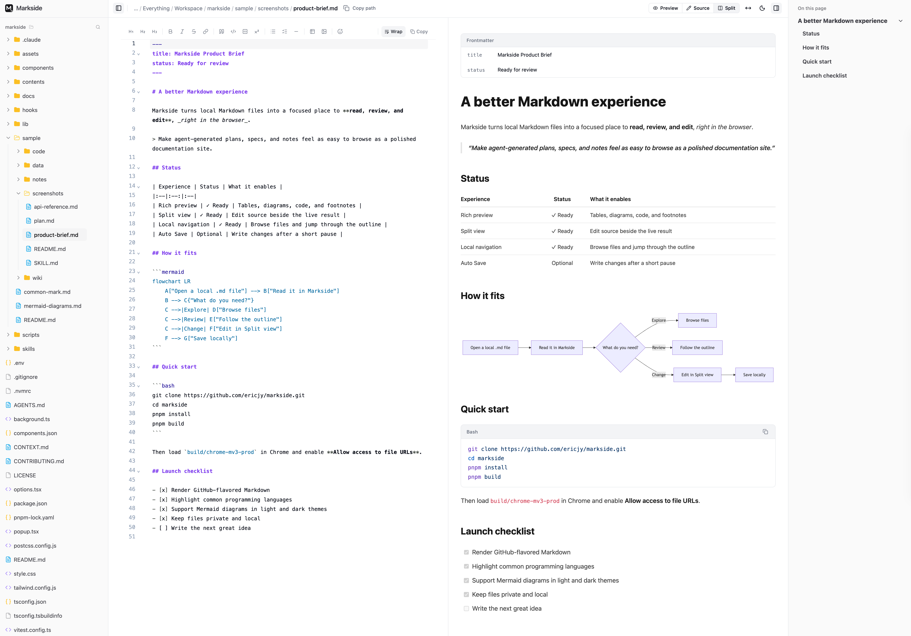

<div align="center">

<a href="https://markside.app"></a>

<h3>Read, review, edit, and share local Markdown in Chrome.</h3>

Built for reviewing the plans, specs, and docs your AI agents write.

[](https://chromewebstore.google.com/detail/markside-%E2%80%94-markdown-viewe/ccokohfaicfjkilcakhnlckbbkhhknhj)
[](https://chromewebstore.google.com/detail/markside-%E2%80%94-markdown-viewe/ccokohfaicfjkilcakhnlckbbkhhknhj)
[](https://github.com/ericjy/markside/actions/workflows/ci.yml)
[](LICENSE)

**[Website](https://markside.app)** ·
**[Install](https://chromewebstore.google.com/detail/markside-%E2%80%94-markdown-viewe/ccokohfaicfjkilcakhnlckbbkhhknhj)** ·
**[User Guide](docs/user-guide.md)** ·
**[Changelog](CHANGELOG.md)**

<sub>WORKS WITH</sub><br/>
&nbsp;&nbsp;
&nbsp;&nbsp;
&nbsp;&nbsp;
&nbsp;&nbsp;
&nbsp;&nbsp;
&nbsp;&nbsp;
&nbsp;&nbsp;


</div>

<br/>



## Why Markside

Coding agents write a lot of Markdown: plans, specs, notes, and skills. Reading
it raw in a terminal is awkward, precise feedback means copying and pasting
quotes, and a one-word fix means opening an IDE or asking the agent to make it.

Markside turns the browser you already have open into a Markdown workspace:

- **Read comfortably.** Rendered tables, diagrams, math, and code instead of raw syntax.
- **Review precisely.** Comment on passages like in Google Docs, then copy one agent-ready prompt.
- **Edit instantly.** Fix a typo yourself in Source or Split view and save it back to disk.
- **Share easily.** Send a rendered, read-only snapshot that opens in any browser.

Everything runs locally. No account, no telemetry.

## Install

1. [Install Markside from the Chrome Web Store](https://chromewebstore.google.com/detail/markside-%E2%80%94-markdown-viewe/ccokohfaicfjkilcakhnlckbbkhhknhj).
2. Open `chrome://extensions`, select Markside's **Details**, and enable
   **Allow access to file URLs**.
3. Open a local `.md`, `.mdx`, or `.markdown` file in Chrome.
4. Choose **Open Folder** to browse related files.

See the [user guide](docs/user-guide.md) for editing, saving, Review Comments,
keyboard shortcuts, and sharing.

## Features

- **Rich Markdown:** frontmatter, tables, task lists, GitHub-style alerts,
  footnotes, math, wikilinks, heading anchors, and relative images.
- **Code and diagrams:** syntax highlighting with copy buttons, and Mermaid
  diagrams that follow the active theme.
- **Agent-ready Review:** anchored Review Comments and an optional Review Note,
  copied as one structured prompt or one comment at a time.
- **Preview, Source, and Split:** a CodeMirror editor beside the live preview,
  with a resizable divider.
- **Safe saving:** `Cmd+S` / `Ctrl+S` writes the original file. Auto Save is
  optional, and external changes are caught before they are overwritten.
- **Local navigation:** a persistent file tree, breadcrumbs, document outline,
  and a `Cmd+P` / `Ctrl+P` quick switcher.
- **Snapshot sharing (Beta):** read-only links that recipients open without
  installing anything.
- **More file types:** edit text and code files in Source view and open images
  directly.
- **Light and dark themes** that follow your system or your choice.

## Open files from an agent

The optional Beta Agent Skill lets a coding agent open the Markdown file it just
created or referenced in Chrome:

```bash
npx skills add ericjy/markside --skill markside -g
```

Ask the agent to run `/markside` or say "open this in Markside." Hosts may use a
different invocation syntax, such as `$markside` in Codex. See the
[Agent Skill guide](docs/user-guide.md#open-from-an-agent) for setup and supported
platforms.

## Privacy and sharing

Ordinary local reading, editing, and Reviews stay in your browser. Markside has
no analytics or telemetry.

Optional snapshot sharing creates a read-only copy of saved Markdown. A Link
Snapshot encodes the content in the URL without uploading it. A Hosted Snapshot
encrypts it in your browser before uploading ciphertext, with the key kept in
the URL fragment. Anyone with the complete link can read a snapshot. See the
[sharing guide](docs/user-guide.md#share-link) and
[privacy policy](https://markside.app/privacy) for limits and expiration details.

## Build from source

Install Node.js using the version in `.nvmrc` and pnpm 10.28.2. The build also
needs `rsvg-convert` for the extension icon. On macOS, install it with
`brew install librsvg`; on Debian or Ubuntu, use `sudo apt-get install librsvg2-bin`.

```bash
git clone https://github.com/ericjy/markside.git
cd markside
nvm use
npm install --global pnpm@10.28.2
pnpm install --frozen-lockfile
pnpm build
```

In `chrome://extensions`, enable **Developer mode**, choose **Load unpacked**,
and select `build/chrome-mv3-prod`. Enable **Allow access to file URLs** for this
installation too.

## Develop

```bash
pnpm dev        # development build in build/chrome-mv3-dev
pnpm typecheck  # TypeScript checks
pnpm test       # Vitest suite
pnpm build      # production build
```

Load `build/chrome-mv3-dev` as an unpacked extension while developing. Reload the
extension and local file when needed. See the [development guide](docs/dev-guide.md)
and [system design](docs/system-design.md) for build details and architecture.

## Contribute

Bug reports, focused fixes, and documentation improvements are welcome. Read
[CONTRIBUTING.md](CONTRIBUTING.md), run `pnpm typecheck` and `pnpm test`, and
complete the [manual Chrome checklist](docs/manual-test.md) for UI changes.

## License

[MIT](LICENSE)
