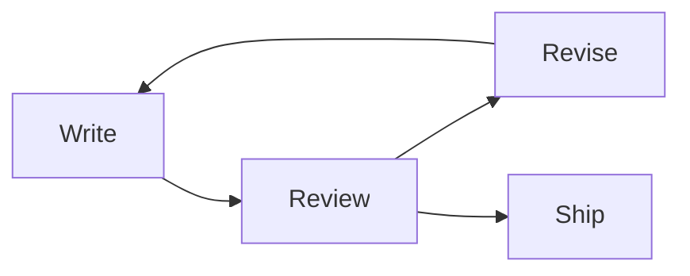

# Markside sample

Markside renders Markdown as you write. Edit this text on the right and watch the Preview on the left. Use **bold**, *italic*, `inline code`, and [links](https://markside.app).

> [!TIP]
> Press Ctrl+E to switch between Source and Preview, or choose Split to see both.

## This week

- [x] Draft the rollout plan
- [ ] Review the agent's spec
- [ ] Share a snapshot with the team

| Step | Owner | Status |
| --- | --- | --- |
| Plan | Agent | Done |
| Review | You | In progress |
| Ship | Team | Next |

## Code

```ts
export function retryDelay(attempt: number): number {
  return Math.min(1000 * 2 ** attempt, 30_000)
}
```

## Math

The delay grows as $d = \min(1000 \cdot 2^n, 30000)$, so the total wait after $n$ retries is

$$
\sum_{k=0}^{n-1} 1000 \cdot 2^k = 1000\,(2^n - 1)
$$

## Diagram



> [!NOTE]
> Save with ⌘S to choose where this file lives. Images and links relative to the file work after you reopen it from its folder.
