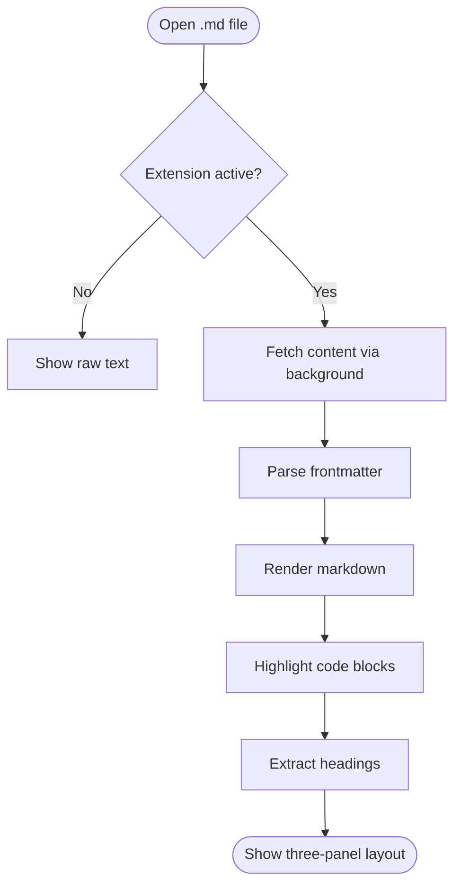
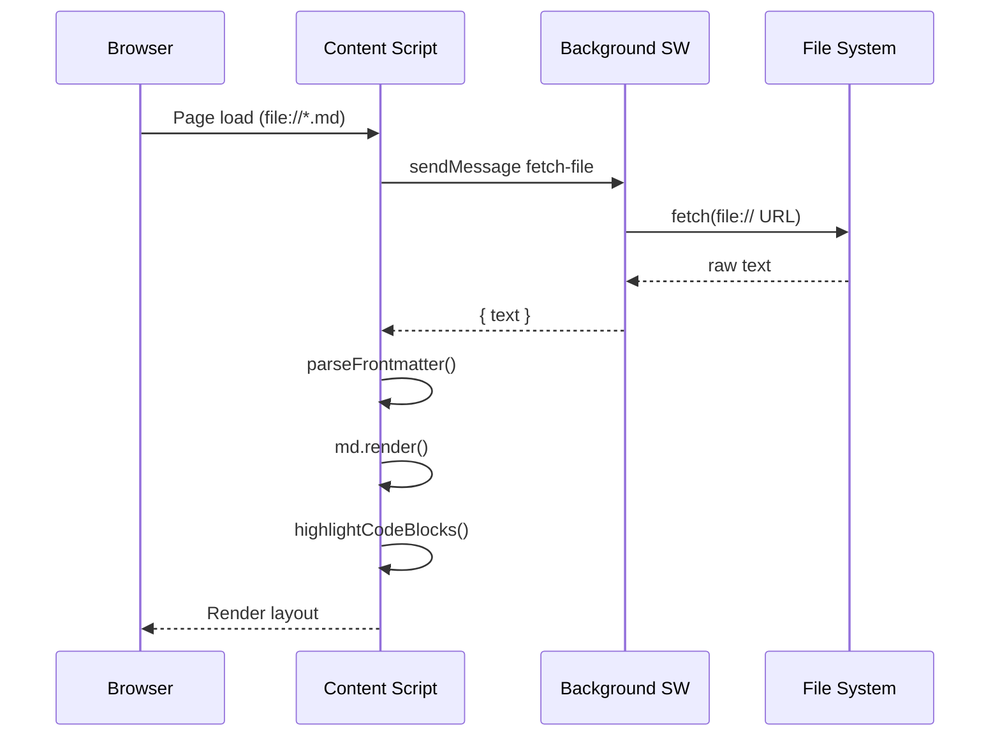
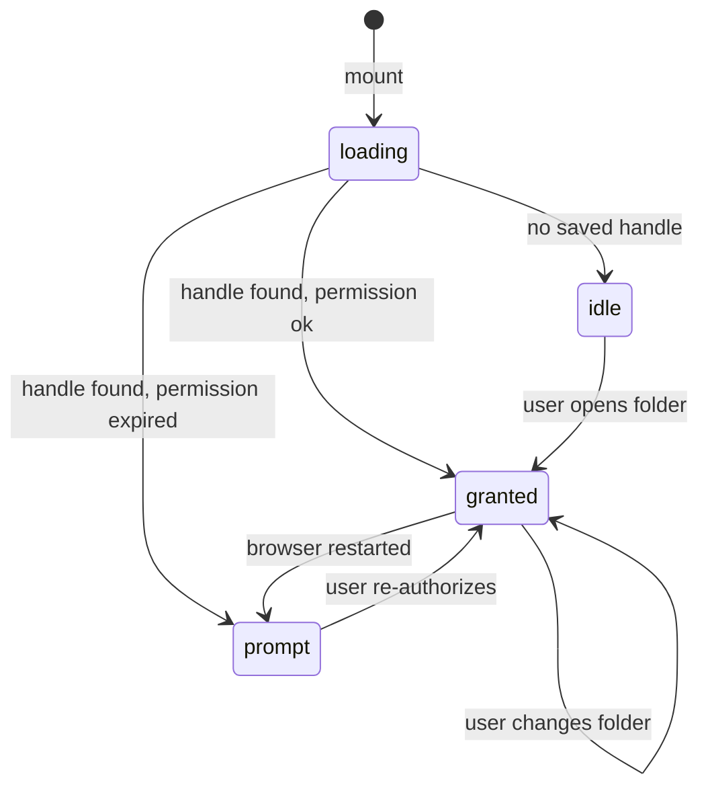
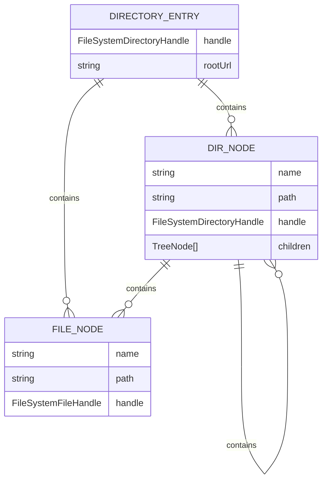
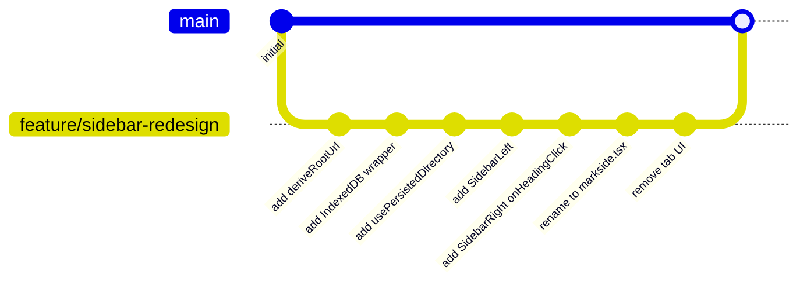
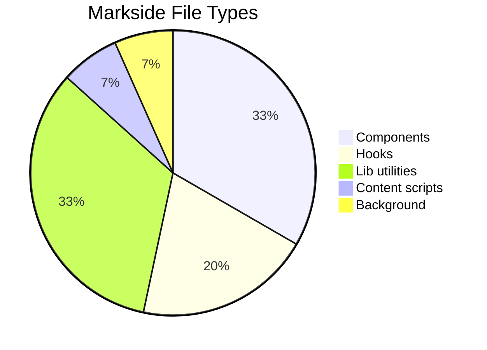
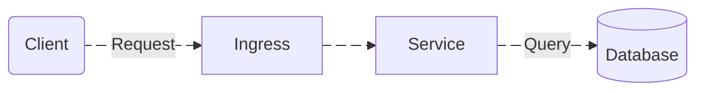

# Diagram Tests

Test file for Mermaid diagram rendering.

## Flowchart

## Sequence Diagram

## State Diagram

## Entity Relationship

## Git Graph

## Pie Chart

## Animated Edges

Give an edge an ID with `id@-->`, then set `animate` on it. `animation` accepts `slow` or `fast` and defaults to `fast`.

