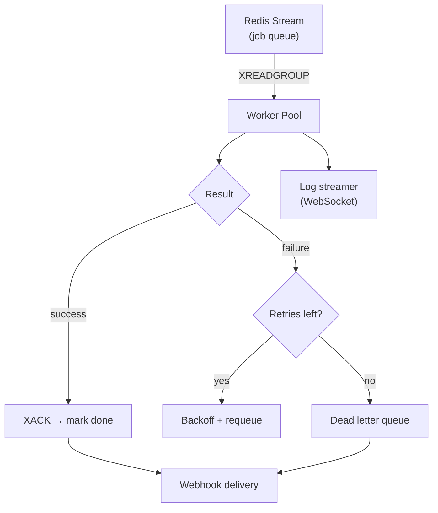

# Orbit Worker

## Tasks

- [x] Design job schema and state machine
- [x] Set up Redis Streams consumer group
- [x] Implement job pickup with concurrency limit
- [x] Add exponential backoff retry logic
- [x] Stream logs via WebSocket
- [ ] Add HMAC-SHA256 webhook delivery
- [ ] Write integration tests (target: 90% coverage)
- [ ] Load test at 10k jobs/min

## Architecture



## Worker Implementation

```typescript
import { createClient } from "redis"
import { deliverWebhook } from "./webhooks"
import { streamLogs } from "./logs"

const CONSUMER_GROUP = "workers"
const BLOCK_MS = 5000
const MAX_RETRIES = 3

async function runWorker(workerId: string) {
  const redis = createClient({ url: process.env.REDIS_URL })
  await redis.connect()

  while (true) {
    const entries = await redis.xReadGroup(
      CONSUMER_GROUP,
      workerId,
      [{ key: "jobs", id: ">" }],
      { COUNT: 1, BLOCK: BLOCK_MS }
    )

    if (!entries) continue

    for (const { id, message } of entries[0].messages) {
      const job = JSON.parse(message.payload)

      try {
        await streamLogs(job.id, () => execute(job.command))
        await redis.xAck("jobs", CONSUMER_GROUP, id)
        await deliverWebhook(job, "job.success")
      } catch (err) {
        const attempts = (job.attempts ?? 0) + 1
        if (attempts < MAX_RETRIES) {
          const delay = Math.pow(2, attempts) * 1000
          await requeueWithDelay(redis, job, attempts, delay)
        } else {
          await redis.xAdd("jobs:dead", "*", { payload: JSON.stringify(job) })
          await deliverWebhook(job, "job.failed")
        }
        await redis.xAck("jobs", CONSUMER_GROUP, id)
      }
    }
  }
}
```
