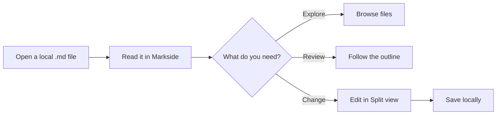

# Markside Product Brief

Markside turns local Markdown files into a focused place to **read, review, and edit**, _right in the browser_.

> Make agent-generated plans, specs, and notes feel as easy to browse as a polished documentation site.

## Status

| Experience | Status | What it enables |
|:--|:--:|:--|
| Rich preview | ✓ Ready | Tables, diagrams, code, and footnotes |
| Split view | ✓ Ready | Edit source beside the live result |
| Local navigation | ✓ Ready | Browse files and jump through the outline |

## How it works



## Quick start

```bash
git clone https://github.com/ericjy/markside.git
cd markside
pnpm install
pnpm build
```

Then load `build/chrome-mv3-prod` in Chrome and enable **Allow access to file URLs**.

## Launch checklist

- [x] Render GitHub-flavored Markdown
- [x] Highlight common programming languages
- [x] Support Mermaid diagrams in light and dark themes
- [x] Keep files private and local
