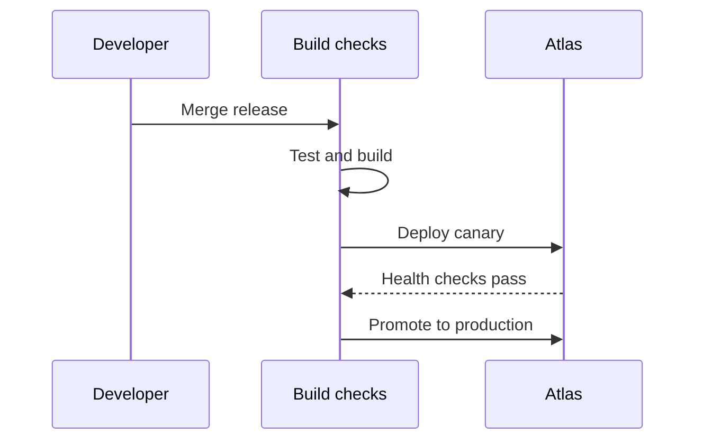

# Atlas release brief

Atlas keeps _every_ deployment **small, visible, and reversible**.

> [!NOTE]
> The release candidate is live in staging. Production rollout starts Thursday at 10:00 AM.

### Before launch

- [x] Run the migration in staging
- [ ] Verify the rollback path
 
> [!TIP]
> Prompt the agent to run the migration for you.

## Release snapshot

| Workstream | Status | Owner |
|:--|:--:|:--|
| API gateway | ✓ Ready | Maya |
| Web dashboard | ✓ Ready | Theo |
| Usage alerts | In review | Lin |

## Deployment sequence



## Health check

```typescript
const release = await atlas.deploy({
  service: "gateway",
  strategy: "canary",
  traffic: 10,
})

await release.waitForHealthy({ timeout: "5m" })
```

