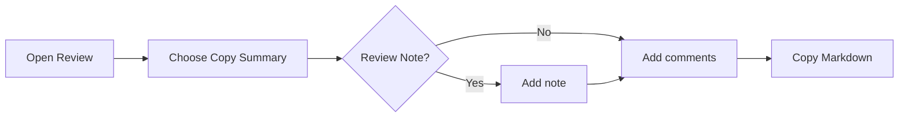

# Spec: Review Summary Export

Create a concise Markdown summary from the active Review so an agent can act on feedback.

> [!IMPORTANT]
> Export only comments the user explicitly included. Never send file contents over the network.

## Scope

- [x] Preserve comment order and selected passages
- [ ] Add **Copy Summary** to the Review menu

## Design



| Field | Required | Format |
| --- | :---: | --- |
| File | Yes | Relative path |
| Comment | Yes | Numbered instruction |

```typescript
export function formatReview(review: Review): string {
  return review.comments
    .map((comment, index) =>
      `${index + 1}. ${comment.instruction}`
    )
    .join("\n")
}
```

