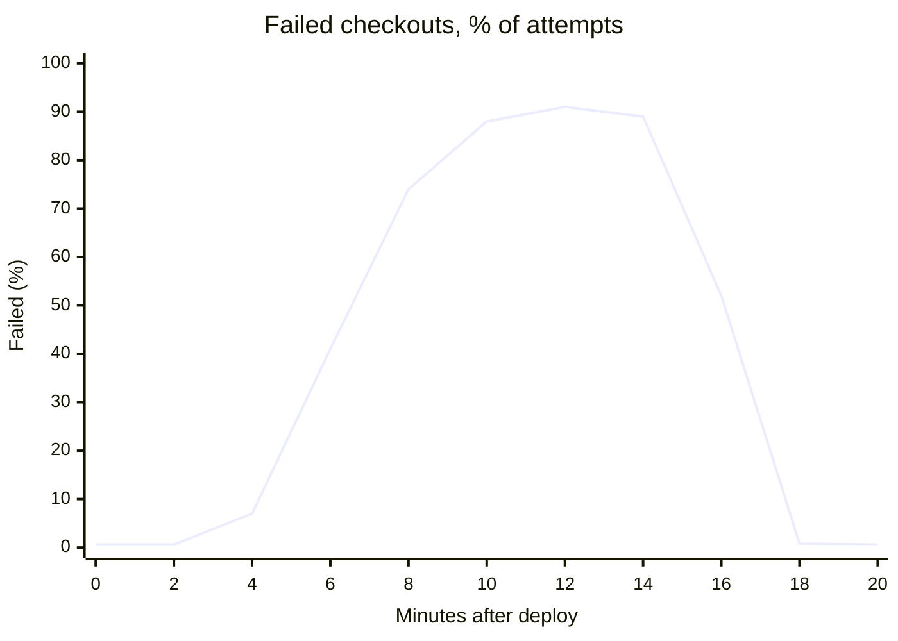
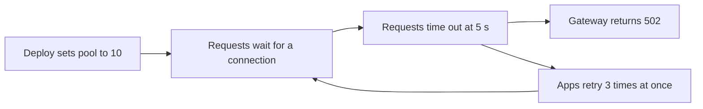

# Postmortem: Fourteen minutes of failed checkouts

On October 14, from 14:06 to 14:20 UTC, most checkout attempts failed with `502 Bad Gateway`. A configuration change shrank the database connection pool from 50 to 10, checkout requests queued for a connection until they timed out, and client retries multiplied the load. Rolling back the change ended the outage.

> [!CAUTION]
> 4,180 checkouts failed. 2,968 customers retried successfully within the hour. We are contacting the remaining 1,212 directly.

## Impact

| Measure | Normal | During the incident |
| --- | ---: | ---: |
| Checkout success rate | 99.4% | 11.8% |
| p99 checkout latency | 420 ms | 5,000 ms (timeout) |
| Requests per second at the gateway | 900 | 2,650 |
| Support tickets | ~6 per hour | 214 |



## Timeline

All times are UTC.

| Time | Event |
| --- | --- |
| 14:02 | Deploy 4812 starts. It includes a shared config cleanup. |
| 14:06 | Checkout error rate passes 5%. The first alert fires. |
| 14:08 | On-call engineer acknowledges and opens the incident channel. |
| 14:09 | Investigation starts with the database. CPU is at 35%, so it looks healthy. |
| 14:15 | Someone notices `pool_wait_seconds` at 4.9 s on every checkout pod. |
| 14:17 | Rollback of deploy 4812 starts. |
| 14:20 | Error rate is back under 1%. |
| 14:45 | Retry queue is drained. Incident closed. |

## What happened



The cleanup moved database settings from each service's config into a shared file. Checkout had overridden the pool size to 50; the shared file used the library default of 10.

```diff
  # services/checkout/config.yaml
  database:
    url: ${CHECKOUT_DB_URL}
-   pool_size: 50
-   pool_timeout: 5s
+   <<: *shared_database
```

### Why 10 connections could never be enough

By Little's law, the number of connections in use equals the arrival rate times how long each request holds one:

$$
L = \lambda W = 900\ \tfrac{\text{req}}{\text{s}} \times 0.04\ \text{s} = 36 \text{ connections}
$$

With a pool of 10, at most $10 / 0.04 = 250$ requests per second could be served. The other 650 waited, timed out, and came back as retries, which is how the gateway saw nearly three times its usual traffic.

> [!NOTE]
> This review is blameless. The config change was reviewed and approved by two people, and nothing in the diff showed that a service-specific override was being dropped.

## What went well

- The first alert fired within four minutes of the deploy.
- Rollback took three minutes once we chose to do it.
- The payment provider never charged a failed checkout, so there were no refunds to issue.

## What went poorly

- We spent six minutes on database CPU instead of connection wait time. The pool was the bottleneck, not the database.
- The mobile app retries three times immediately with no backoff.[^backoff]
- Nothing showed the *effective* config of a service, only the files that produce it.

> [!TIP]
> `pool_wait_seconds` is now on the checkout dashboard, directly above database CPU.

## Action items

- [x] Restore `pool_size: 50` for checkout — **Luis**, done Oct 14
- [x] Add `pool_wait_seconds` to the checkout dashboard — **Dana**, done Oct 15
- [ ] Print the effective config diff in every deploy summary — **Platform**, due Nov 1
- [ ] Alert when pool wait p99 exceeds 100 ms — **Dana**, due Nov 1
- [ ] Exponential backoff with jitter in the mobile app — **Mobile**, ships in 6.12
- [ ] Load test checkout at 3× peak before the holiday freeze — **Luis**, due Nov 15

> [!WARNING]
> Until the backoff fix ships, any checkout slowdown will triple gateway traffic. Treat checkout latency alerts as urgent.

## Lessons

> A shared default is a change to every service that never set the value, even when the diff only touches one file.

1. Review the configuration a service *runs with*, not the files that build it.
2. Watch the resource that requests wait on, not just the busiest machine.
3. Retries without backoff turn a slowdown into an outage.[^retries]

[^backoff]: Added in 2019, when checkout had a single server and an immediate retry usually reached a healthy one.
[^retries]: The web client already used backoff. Its share of the extra traffic was under 4%.
