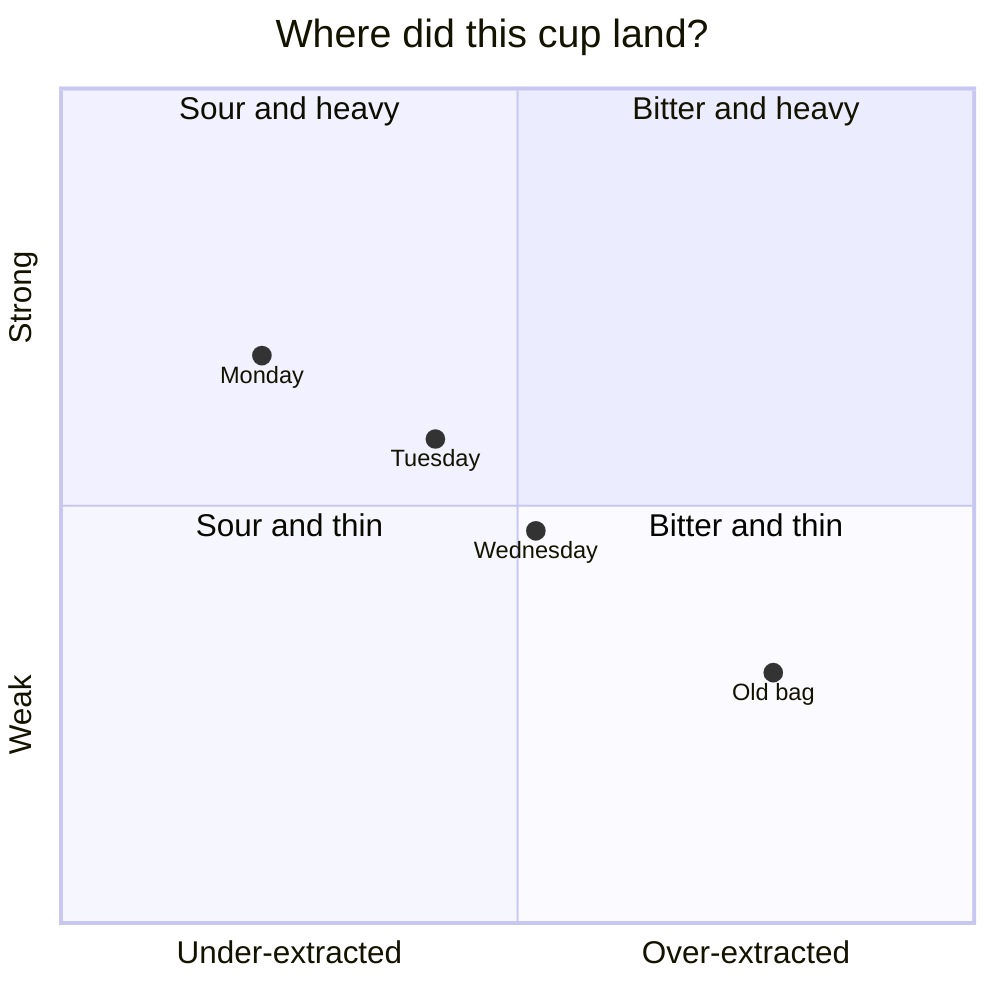
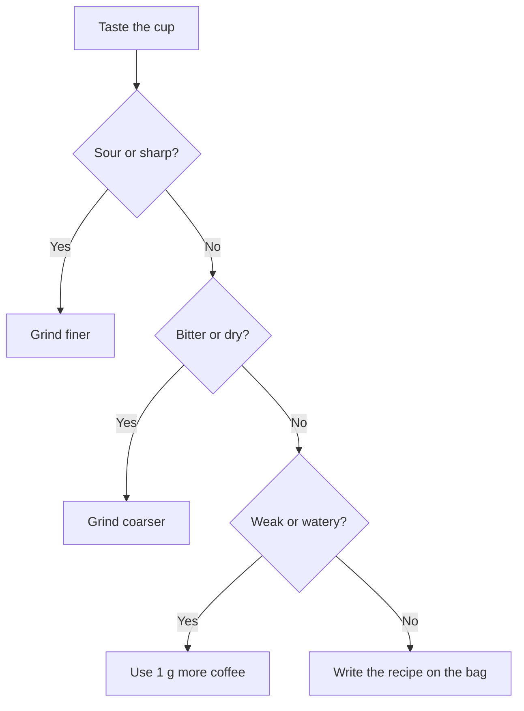

# Pour-over, dialed in

A good pour-over needs three things: the right ratio, an even pour, and a grind you adjust by taste rather than by habit. This guide is the recipe I start every new bag with, and the way I fix it when the cup is off.

> [!TIP]
> Change one thing per cup. If you change the grind and the ratio together, you won't know which one helped.

## The recipe

| Time | Pour to | What to do |
| --- | ---: | --- |
| 0:00 | 45 g | Bloom: wet all the grounds, then swirl once |
| 0:45 | 150 g | Pour in slow circles, avoiding the paper |
| 1:30 | 250 g | Finish the pour, then give the dripper a gentle spin |
| 3:00 | — | Drawdown should be done. If not, grind coarser next time |

## Ratio and strength

The ratio is just water divided by coffee:

$$
\text{ratio} = \frac{\text{water}}{\text{coffee}} = \frac{250\ \text{g}}{15\ \text{g}} \approx 16.7
$$

Strength is how much coffee ends up dissolved in the cup. If you have a refractometer, it measures total dissolved solids (TDS), and you can work out the extraction yield:

$$
\text{EY} = \frac{\text{TDS} \times \text{beverage}}{\text{dose}} = \frac{1.35\% \times 220\ \text{g}}{15\ \text{g}} \approx 19.8\%
$$

The grounds hold back about 2 g of water per gram of coffee, which is why 250 g in gives about 220 g out. Most people like an extraction yield between $18\%$ and $22\%$.[^scaa]

> [!NOTE]
> You don't need a refractometer. Your tongue is a good enough instrument once you know what to taste for.

## Reading the cup

Sourness means the water didn't pull out enough; bitterness and a dry finish mean it pulled out too much. Thin or heavy is about the ratio, not the grind.

## Fixing it

## Grind sizes

| Brewer | Grind | Feels like |
| --- | --- | --- |
| Espresso | Fine | Flour |
| V60 | Medium-fine | Table salt |
| Chemex | Medium-coarse | Kosher salt |
| French press | Coarse | Breadcrumbs |

> [!WARNING]
> Water just off the boil, around 100 °C, makes light roasts taste great and dark roasts taste burnt. For dark roasts, drop to 88 °C.

## Before you brew

- [x] Rinse the paper filter with hot water and throw that water away
- [x] Weigh the coffee, not the beans' volume
- [ ] Grind right before brewing
- [ ] Start the timer with the first pour, not before

> Coffee is a recipe you can taste your way into. Write down what you did, and the next cup will be better than this one.

[^scaa]: This range comes from brewing research done in the 1950s and still used in coffee brewing standards today. Treat it as a starting point, not a rule.
