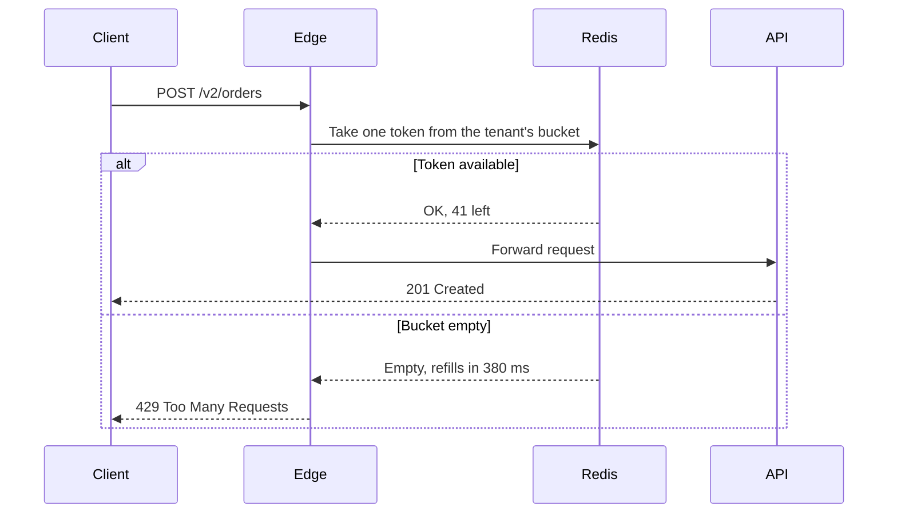

# Per-tenant rate limits

One noisy tenant can still slow the API down for everyone. This RFC replaces the global request cap with a token bucket per tenant, enforced at the edge, so a burst from one customer never spends another customer's capacity.

> [!IMPORTANT]
> Existing integrations keep working. Every plan gets a limit of at least twice its observed p99 traffic, and nothing is enforced until shadow mode ends on November 18.

## How a request is admitted



## Limits by plan

| Plan | Sustained | Burst | Observed p99 |
| --- | ---: | ---: | ---: |
| Free | 5 req/s | 20 | 1.8 req/s |
| Team | 50 req/s | 200 | 19 req/s |
| Business | 250 req/s | 1,000 | 96 req/s |
| Enterprise | Custom | Custom | — |

## The bucket

A bucket holds at most $b$ tokens and refills at $r$ tokens per second. When a request arrives at time $t$, the edge first tops the bucket up:

$$
\text{tokens}(t) = \min\bigl(b,\; \text{tokens}(t_0) + r\,(t - t_0)\bigr)
$$

If fewer than one token remains, the client waits $\frac{1 - \text{tokens}(t)}{r}$ seconds, which the edge returns in `Retry-After`.

```go
func (b *Bucket) Take(now time.Time) (ok bool, wait time.Duration) {
	elapsed := now.Sub(b.updated).Seconds()
	b.tokens = math.Min(b.burst, b.tokens+elapsed*b.rate)
	b.updated = now

	if b.tokens < 1 {
		return false, time.Duration((1 - b.tokens) / b.rate * float64(time.Second))
	}
	b.tokens--
	return true, 0
}
```

The production version runs as a single Redis script so that two edge nodes can never spend the same token.

## What clients see

```http
HTTP/1.1 429 Too Many Requests
Retry-After: 1
RateLimit-Limit: 50
RateLimit-Remaining: 0
RateLimit-Reset: 1
```

> [!TIP]
> The official SDKs already retry on `429` with `Retry-After`. Customers using them need no changes.

## Rollout

- [x] Ship the bucket behind a flag, logging only
- [x] Backfill p99 traffic for every tenant
- [ ] Shadow mode for two weeks, alerting on would-be rejections
- [ ] Email the 31 tenants who would have been limited
- [ ] Enforce for Free, then Team, then everyone

## Open questions

1. Should limits be per API key or per tenant? Per tenant is simpler, but one leaked key could exhaust a whole organization.
2. Do webhooks retried by us count against the customer's limit? Today they would.[^webhooks]

[^webhooks]: Retried webhooks are outbound traffic, so the edge never sees them. This only matters if we later limit inbound webhook acknowledgements.
